# NOESIS: Neural-Ontological Evidence Synthesis and Inference System

[](https://github.com/NavyaNawal/NOESIS/actions/workflows/ci.yml)
[](https://opensource.org/licenses/Apache-2.0)
[](https://www.python.org/downloads/release/python-3110/)
[](https://fastapi.tiangolo.com)
[](https://neo4j.com)
[](https://vitejs.dev)

> **Connect. Reason. Explain.**
> An evidence-native knowledge graph reasoning engine that transforms fragmented, unstructured research information into an explainable, verifiable graph substrate with multi-hop inference, contradiction detection, and counterfactual evidence testing.

---

## 1. Executive Overview

Traditional Information Retrieval (IR) and conventional Retrieval-Augmented Generation (RAG) suffer from hallucinations, inability to expose explicit reasoning paths across multi-document boundaries, and vulnerability to conflicting facts.

**NOESIS** solves this by establishing a **first-class Evidence-Centric Ontology**:
- Factual relationships are reified into **`Claim`** nodes rather than simple direct edges.
- Every claim maintains an explicit link to supporting **`Evidence`** records with exact source quotations and character offsets.
- **Bounded Multi-Hop Traversal** executes deterministic graph queries (1 to 5 hops) across incoming and outgoing predicates with full cycle prevention.
- **Contradiction Detection** models opposing polarities and conflicting temporal validity without blindly relying on majority vote.
- **Evidence Ablation (Counterfactual Testing)** simulates the removal of individual source documents to identify *critical evidence* vs *redundant evidence*.

---

## 2. System Architecture

```mermaid
flowchart TD
    subgraph Sources ["1. Synthetic & Research Sources"]
        D1["Document 1 (TXT/PDF)"]
        D2["Document 2 (TXT/PDF)"]
    end

    subgraph Ingestion ["2. Ingestion & Ontology Layer"]
        DOC["Document Nodes\n(content_hash, metadata)"]
        EVD["Evidence Nodes\n(exact quote, offsets, page)"]
        CLM["Claim Nodes\n(fingerprint, predicate, polarity)"]
        ENT["Entity Nodes\n(canonical_name, type, aliases)"]
    end

    subgraph Storage ["3. Graph Storage Abstraction"]
        GR["GraphRepository Interface"]
        NEO["Neo4j Persistent Store (Bolt)"]
        MEM["In-Memory Traversal Store (Fallback)"]
    end

    subgraph Reasoning ["4. Multi-Hop Reasoning Engine"]
        QP["Structured Query Planner"]
        TRAV["Bounded Traversal Engine\n(Cycle-free, 1-5 Hops)"]
        CONF["Explainable Confidence Heuristic\nC(e) = 0.35Q + 0.30S + 0.20A + 0.15V"]
        ABL["Counterfactual Ablation Engine"]
    end

    subgraph API ["5. FastAPI REST API (v1)"]
        EP["Endpoints: /health, /graph, /documents,\n/entities, /claims, /query/structured"]
    end

    subgraph Frontend ["6. Investigative Workstation"]
        UI1["Investigation Workspace"]
        UI2["Knowledge Graph Explorer (Cytoscape.js)"]
        UI3["Source Vault (Exact Span Inspection)"]
    end

    Sources --> Ingestion
    Ingestion --> Storage
    Storage --> Reasoning
    Reasoning --> API
    API --> Frontend
```



---

## 3. Technology Stack

| Layer | Component | Description |
| :--- | :--- | :--- |
| **Backend Framework** | FastAPI 0.104+ / Python 3.11 | High-performance async API with Pydantic v2 schemas and DI |
| **Graph Database** | Neo4j Community Edition 5.15 | Native labeled property graph store with parameterized Cypher |
| **Graph Fallback** | In-Memory Graph Repository | Native Python adjacency and path traversal engine (zero hardcoded answers) |
| **Reasoning Engine** | Bounded Traversal Service | Deterministic path finding, cycle-check, confidence scoring, ablation |
| **Frontend UI** | React 18 + TypeScript + Vite | Professional dark graphite investigative interface with amber highlights |
| **Graph Visualizer** | Cytoscape.js + CoSE Layout | High-density canvas with interactive node/claim/evidence inspection |
| **Styling & Icons** | Tailwind CSS + Lucide Icons | Research-grade information density; no generic chatbot appearance |
| **Quality & Tests** | Pytest + Ruff | Rigorous test suite validating ontology, traversal, determinism, schemas |

---

## 4. Quickstart Guide

### Prerequisites
- Python 3.11+
- Node.js 20+ and npm
- Docker Desktop (Optional; if Docker is unavailable, the in-memory engine runs automatically)

### Step 1: Clone and Configure
```powershell
git clone https://github.com/NavyaNawal/NOESIS.git
cd NOESIS
cp .env.example .env
```

### Step 2: Backend Setup
```powershell
# In workspace root
python -m pip install -r backend/requirements.txt

# Seed the graph repository (works with Neo4j or In-Memory)
python scripts/seed_graph.py

# Launch FastAPI backend
python -m uvicorn backend.app.main:app --host 0.0.0.0 --port 8000 --reload
```
API Documentation will be live at: `http://localhost:8000/docs`

### Step 3: Frontend Setup
```powershell
cd frontend
npm.cmd install
npm.cmd run dev
```
Workstation will be live at: `http://localhost:5173`

---

## 5. Verification & Testing

Run full test suite:
```powershell
pytest backend/tests -v
```

Lint and format checking:
```powershell
python -m ruff check backend
```

---

## 6. Repository Structure
```
NOESIS/
├── .github/workflows/ci.yml       # GitHub Actions CI workflow
├── backend/
│   ├── app/
│   │   ├── main.py               # FastAPI entrypoint and lifecycle
│   │   ├── config.py             # Pydantic Settings
│   │   ├── api/                  # API routers (/v1)
│   │   ├── schemas/              # Pydantic data schemas
│   │   ├── ontology/             # Evidence-centric ontology models
│   │   ├── graph/                # Repository abstraction, Neo4j & In-Memory
│   │   ├── reasoning/            # Bounded traversal, confidence, ablation
│   │   └── extraction/           # Quotation validator & fingerprinting
│   ├── tests/                    # Pytest test cases
│   └── requirements.txt          # Python dependencies
├── frontend/
│   ├── src/
│   │   ├── components/           # Investigation, Graph Explorer, Source Vault
│   │   ├── services/             # Axios/Fetch API client
│   │   ├── types/                # TypeScript interface definitions
│   │   └── App.tsx               # Main workstation application
│   ├── package.json
│   └── vite.config.ts
├── datasets/
│   ├── synthetic/                # 10 interconnected synthetic source texts
│   └── ground_truth/             # Ground truth queries and reasoning paths
├── scripts/
│   ├── seed_graph.py             # Idempotent corpus seed script
│   └── smoke_test.py             # End-to-end integration test
├── docs/
│   ├── ARCHITECTURE.md           # Detailed architecture specification
│   ├── ONTOLOGY.md               # Evidence-centric ontology documentation
│   ├── REQUIREMENTS_TRACEABILITY.md # IEEE 29148 requirements matrix
│   ├── decisions/                # Architecture Decision Records (ADRs)
│   └── Noesis.pdf                # Original IEEE BMSITM PRD specification
├── PRD.md                        # Preserved PRD specification
├── CITATION.cff                  # Formal research citation metadata
├── CONTRIBUTING.md               # Contribution guidelines
├── CHANGELOG.md                  # Semantic release log
└── docker-compose.yml            # Neo4j community container orchestration
```

---

## 7. Research Integrity & Standards
- Formulated using principles of **ISO/IEC/IEEE 29148** requirements engineering.
- Evaluated against **ISO/IEC 25010** software quality characteristics.
- Synthetic datasets are explicitly tagged and never presented as unverified real-world facts.
