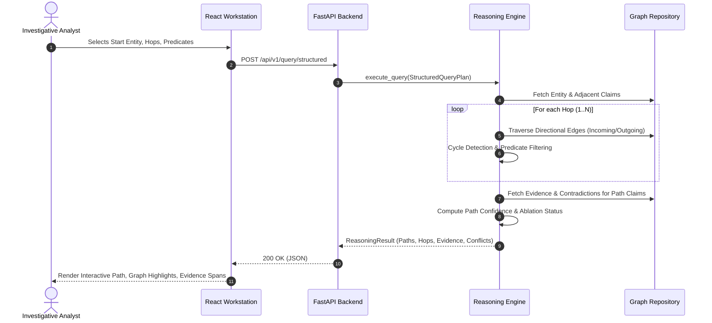

# NOESIS System Architecture

## 1. Architectural Philosophy and Design Principles

NOESIS (**Neural-Ontological Evidence Synthesis and Inference System**) is designed around three foundational engineering principles:

1. **Evidence Reification**: Knowledge in standard graphs is typically represented as a directed triple $(s, p, o)$. This collapses provenance and makes contradiction handling mathematically awkward. NOESIS reifies every factual relation into a discrete `Claim` node, linked to subject and object entities, and supported by one or more `Evidence` nodes.
2. **Deterministic Bounded Traversal**: Unlike probabilistic graph algorithms or unrestricted Cypher queries, NOESIS executes structured, bounded traversals with explicit cycle prevention, direction control, and predicate filtering.
3. **Graceful Storage Degradation**: The core repository layer abstracts graph operations behind an explicit interface (`BaseGraphRepository`), backed by **Neo4j** for persistent deployment and an **In-Memory Graph Engine** for zero-dependency or container-constrained environments.

---

## 2. Component Hierarchy

```
+-------------------------------------------------------------+
|               Investigative Workstation (UI)                |
|  - Workspace (Query Builder & Multi-Hop Path Breakdown)    |
|  - Knowledge Graph Explorer (Cytoscape.js Canvas)           |
|  - Source Vault (Document Reader & Exact Span Verification) |
+------------------------------+------------------------------+
                               | HTTP REST / JSON
+------------------------------v------------------------------+
|                    FastAPI Application                      |
|  - Versioned API Routers (/api/v1/...)                      |
|  - Dependency Injection (get_graph_repo, get_reasoning_svc) |
|  - CORS, Global Error Handling, Structured Logging          |
+------------------------------+------------------------------+
                               |
+------------------------------v------------------------------+
|                 Reasoning & Ontology Layer                  |
|  - Bounded Traversal Service (DFS/BFS Path Enumeration)     |
|  - Confidence Evaluator (C(e) = 0.35Q + 0.30S + 0.20A + 0.15V)
|  - Evidence Ablation Engine (Non-destructive source removal)|
|  - Contradiction Detector (Polarity & Temporal check)       |
|  - Evidence Verifier (Offset & Exact Quotation Validation)  |
+------------------------------+------------------------------+
                               |
+------------------------------v------------------------------+
|                   Graph Repository Layer                    |
|  - BaseGraphRepository (Abstract Protocol)                  |
|  - Neo4jGraphRepository (Parameterized Bolt Cypher Driver)  |
|  - InMemoryGraphRepository (Adjacency Index + Path Traversal)
+-------------------------------------------------------------+
```

---

## 3. Storage Mode Lifecycle

When the FastAPI backend initializes:
1. It reads `GRAPH_STORAGE_MODE` from configuration (defaulting to `neo4j` if configured, or `in_memory`).
2. If `neo4j` is requested, it tests connection to `NEO4J_URI`.
3. If Neo4j is unreachable (e.g. Docker unavailable, connection refused), it logs a warning and automatically falls back to `InMemoryGraphRepository`.
4. The active storage mode is exposed via `GET /api/v1/health` and all graph metadata payloads.

---

## 4. Query Execution Sequence



---

## 5. Entity-Anchored Query Compilation (EAQC)

### 5.1 Problem Statement: Hallucinatory Entity Substitution
When translating arbitrary natural-language research questions into symbolic graph query plans (`StructuredQueryPlan`), generative language models can substitute unrelated entities present in their context window instead of faithfully anchoring to the specific entity named in the user question. In NOESIS, injecting unrelated corpus candidate entities into the query planning prompt caused the model to wander into synthetic benchmark entities (e.g. `Nexus Advanced Research Institute`) rather than anchoring to the intended subject (e.g. `Project Horizon`).

### 5.2 The EAQC Mechanism
To eliminate unconstrained substitution, NOESIS implements **Entity-Anchored Query Compilation (EAQC)**:
1. **Deterministic Mention Resolution**:
   - **Tier 1 (Exact Canonical Match)**: Case-insensitive substring boundary matching against known entity canonical names.
   - **Tier 2 (Exact Normalized Match)**: Normalization stripping honorific prefixes (`Dr.`, `Prof.`, `Mr.`, `Ms.`), punctuation, and extra whitespace.
   - **Tier 3 (Alias Matching)**: Explicit matching against entity alias registries.
   - **Longest-Span Prioritization**: Longer matching entity spans supersede shorter subsets.
2. **Deterministic Anchor Locking**:
   - Upon unique mention resolution, the starting entity is locked directly to the entity identifier (e.g. `ent_project_horizon`).
   - The compiled query plan strictly enforces `start_entity = anchor.id`, regardless of any alternative entity proposed by the generative model.
3. **Prompt Context Reduction**:
   - Rather than broadcasting entire entity catalogs into the prompt, the local model is supplied only with the locked anchor entity details, relational direction rules, and target constraints, eliminating distractor interference and shrinking token consumption.
4. **Semantic Plan Status Codes**:
   - `SUCCESS`: Valid plan compiled and executed to conclusion.
   - `ENTITY_NOT_FOUND`: Query explicitly mentions an unindexed proper noun / entity.
   - `AMBIGUOUS_ENTITY`: Mention matches multiple candidates equally without contextual disambiguation.
   - `QUERY_PLANNING_FAILED`: Malformed syntax or ontology constraint violation.
   - `UNSUPPORTED_CONSTRAINT`: Question includes explicit constraints (such as temporal dates) that cannot be grounded in source evidence.
   - `INSUFFICIENT_EVIDENCE`: Traversal completed without establishing a path to the requested target.
5. **Knowledge Gap Decoupling**:
   - Planner syntax or entity resolution errors are cleanly isolated and never misclassified as graph traversal discontinuities. Knowledge gaps are only diagnosed when a faithful, valid symbolic plan encounters a missing topological edge during actual graph traversal.

