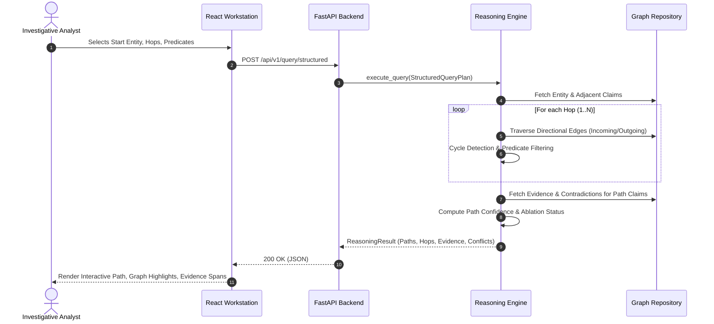

# NOESIS System Architecture

## 1. Architectural Philosophy and Design Principles

NOESIS (**Neural-Ontological Evidence Synthesis and Inference System**) is designed around three foundational engineering principles:

1. **Evidence Reification**: Knowledge in standard graphs is typically represented as a directed triple $(s, p, o)$. This collapses provenance and makes contradiction handling mathematically awkward. NOESIS reifies every factual relation into a discrete `Claim` node, linked to subject and object entities, and supported by one or more `Evidence` nodes.
2. **Deterministic Bounded Traversal**: Unlike probabilistic graph algorithms or unrestricted Cypher queries, NOESIS executes structured, bounded traversals with explicit cycle prevention, direction control, and predicate filtering.
3. **Graceful Storage Degradation**: The core repository layer abstracts graph operations behind an explicit interface (`BaseGraphRepository`), backed by **Neo4j** for persistent deployment and an **In-Memory Graph Engine** for zero-dependency or container-constrained environments.

---

## 2. Component Hierarchy

```
+-------------------------------------------------------------+
|               Investigative Workstation (UI)                |
|  - Workspace (Query Builder & Multi-Hop Path Breakdown)    |
|  - Knowledge Graph Explorer (Cytoscape.js Canvas)           |
|  - Source Vault (Document Reader & Exact Span Verification) |
+------------------------------+------------------------------+
                               | HTTP REST / JSON
+------------------------------v------------------------------+
|                    FastAPI Application                      |
|  - Versioned API Routers (/api/v1/...)                      |
|  - Dependency Injection (get_graph_repo, get_reasoning_svc) |
|  - CORS, Global Error Handling, Structured Logging          |
+------------------------------+------------------------------+
                               |
+------------------------------v------------------------------+
|                 Reasoning & Ontology Layer                  |
|  - Bounded Traversal Service (DFS/BFS Path Enumeration)     |
|  - Confidence Evaluator (C(e) = 0.35Q + 0.30S + 0.20A + 0.15V)
|  - Evidence Ablation Engine (Non-destructive source removal)|
|  - Contradiction Detector (Polarity & Temporal check)       |
|  - Evidence Verifier (Offset & Exact Quotation Validation)  |
+------------------------------+------------------------------+
                               |
+------------------------------v------------------------------+
|                   Graph Repository Layer                    |
|  - BaseGraphRepository (Abstract Protocol)                  |
|  - Neo4jGraphRepository (Parameterized Bolt Cypher Driver)  |
|  - InMemoryGraphRepository (Adjacency Index + Path Traversal)
+-------------------------------------------------------------+
```

---

## 3. Storage Mode Lifecycle

When the FastAPI backend initializes:
1. It reads `GRAPH_STORAGE_MODE` from configuration (defaulting to `neo4j` if configured, or `in_memory`).
2. If `neo4j` is requested, it tests connection to `NEO4J_URI`.
3. If Neo4j is unreachable (e.g. Docker unavailable, connection refused), it logs a warning and automatically falls back to `InMemoryGraphRepository`.
4. The active storage mode is exposed via `GET /api/v1/health` and all graph metadata payloads.

---

## 4. Query Execution Sequence


